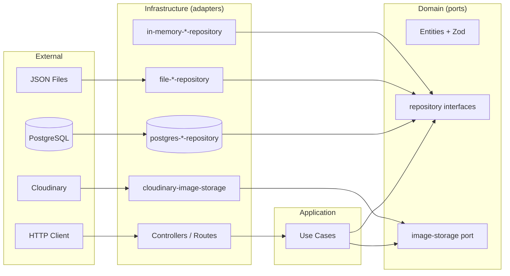

# Tournament API

Backend for managing sports tournaments: tournaments, teams, players, fixtures, results, standings, venues and referees.

Built with **Express 5 + TypeScript**, following a **hexagonal architecture** and a domain layer focused on **pragmatic DDD**. Persistence is swappable (PostgreSQL or JSON files) without touching the business logic.

> Frontend: see [tournament-fe](https://github.com/4gustinDominguez/tournament-fe).

## Stack

| Area | Technology |
| --- | --- |
| Runtime | Node.js ≥ 22 |
| HTTP framework | Express 5 |
| Language | TypeScript 5.9 (`strict`) |
| Validation | Zod 4 (in the domain layer) |
| Persistence | PostgreSQL (`pg` + pgbouncer) or JSON files |
| Auth | JWT (`jsonwebtoken`) + `bcryptjs` |
| Images | Cloudinary |
| Tests | Cucumber (Gherkin) + Chai |
| Lint / Format | ESLint (eslint-config-codely) + Prettier |

## Hexagonal architecture

Every module follows the same vertical pattern of three layers, where **dependencies point inwards**: the domain knows nothing about Express, `pg` or the filesystem.

```
src/
├── <module>/
│   ├── domain/           # Entities, Zod validators and PORTS (interfaces)
│   ├── application/      # Use cases — all the business logic lives here
│   └── infrastructure/   # HTTP adapters (controllers/routes) and persistence adapters
├── shared/
│   ├── domain/           # Cross-cutting ports (image-storage, email)
│   └── infrastructure/   # db, repository.factory, concrete adapters
└── index.ts              # Entry point: middlewares + router mounting
```



### Port-adapter in practice

Repositories are interfaces in `domain/` with **three implementations** each (PostgreSQL, JSON files, in-memory). Selection is a deployment concern, not a business one, and it is resolved in `shared/infrastructure/repository.factory.ts`:

- `DATABASE_URL` set and `STORAGE != "json"` → PostgreSQL
- otherwise → JSON files in `data/`

The BDD tests run against the **in-memory** adapters: same use cases, zero infrastructure.

### Decisions (and trade-offs)

- **Pragmatic domain, not ceremonial.** Entities are types with Zod validation; behavior lives in use cases. There are no aggregates or value objects because this domain (CRUD + ownership rules + standings) does not justify them.
- **Business errors as messages from a single source** (`error.message`), mapped to HTTP responses in controllers. It is simple and readable; the cost is that controllers compare strings — a natural next step is typed errors.
- **Three persistence adapters** cost code lines in exchange for testing business logic without a database and switching storage via an environment variable.

## Requirements

- Node.js 22+ (see `.nvmrc`)
- pnpm
- A PostgreSQL instance is **optional**: without `DATABASE_URL`, the API runs on JSON files (handy for local development and demos).

## Getting started

```bash
pnpm install
cp .env.example .env   # fill in as needed
pnpm dev               # http://localhost:3000
```

Without `DATABASE_URL`, data is persisted to `data/`. To seed a PostgreSQL database:

```bash
pnpm build
pnpm seed
```

### Environment variables

| Variable | Required | Description |
| --- | --- | --- |
| `DATABASE_URL` | No | PostgreSQL connection string. If missing, file storage is used (`STORAGE=json`) |
| `STORAGE` | No | `json` forces the file adapter even when `DATABASE_URL` exists |
| `DB_SSL` | No | `true` to enable SSL on the connection |
| `JWT_SECRET` | Yes (production) | Token signing secret; falls back to a local value in dev |
| `NODE_ENV` | No | `production` / `development` |
| `PORT` | No | HTTP port (defaults to `3000`) |
| `CORS_ORIGIN` | No | Allowed origins, comma-separated. If missing, any origin is reflected |
| `FRONTEND_URL` | No | Base URL for generated links (defaults to `http://localhost:3001`) |
| `CLOUDINARY_*` | No | Cloudinary credentials for image storage |
| `MJ_APIKEY_*`, `EMAIL_FROM*` | No | Transactional email provider. If missing, sending is skipped without breaking startup |
| `DATA_DIR` | No | Data directory for the seed (defaults to `./data`) |

## Scripts

| Command | Description |
| --- | --- |
| `pnpm dev` | Development with nodemon |
| `pnpm build` | Compile to `dist/` (`tsc` + `tsc-alias`) |
| `pnpm start` | Run the build |
| `pnpm seed` | Populate the database from `data/` |
| `pnpm lint` | ESLint |
| `pnpm typecheck` | TypeScript type checking (`tsc --noEmit`) |
| `pnpm test` | Cucumber acceptance scenarios |

## Testing

Tests are **executable specification** written in Gherkin (`features/`): 36 scenarios covering tournaments, teams, matches, players, venues, rounds and auth.

```bash
pnpm test
```

The step definitions call the use cases directly with in-memory repositories (`features/step_definitions/test-repositories.ts`), so they exercise the full business logic without spinning up HTTP or touching the database.

## Documentation

| Doc | Contents |
| --- | --- |
| [docs/architecture.md](docs/architecture.md) | Layers, ports/adapters, composition, trade-offs |
| [docs/business-rules.md](docs/business-rules.md) | Domain rules and their state in the code |
| [docs/roles.md](docs/roles.md) | RBAC roles and capabilities matrix |
| [docs/image-storage.md](docs/image-storage.md) | Decision log: Cloudinary vs alternatives |
| [docs/api/](docs/api/) | Endpoint reference with `curl` examples |

