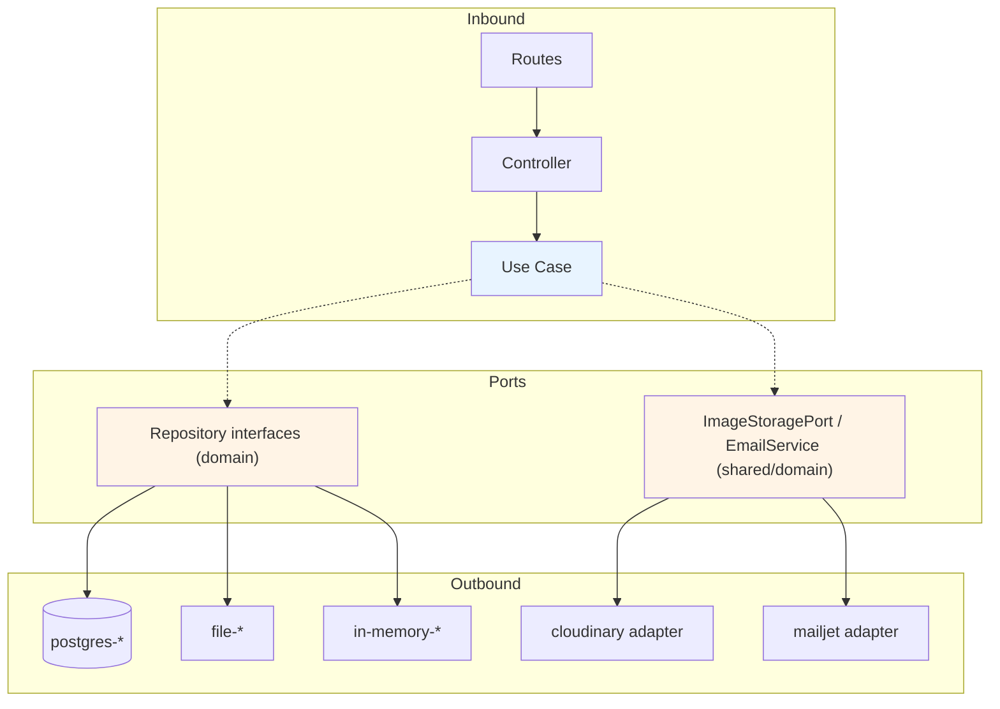

# Architecture

This document explains how the Tournament API is structured and *why*. For a quick start, see the [README](../README.md).

## Goals

1. **Business logic that survives infrastructure changes.** Rules live where they can be tested without Express, a database or the filesystem.
2. **Dependencies point inwards.** Domain → Application → Infrastructure. Nothing in `domain/` or `application/` imports `express`, `pg` or `fs`.
3. **Pragmatism over ceremony.** We adopt DDD techniques only where they pay for themselves in this domain.

## Layer by layer

```
src/<module>/
├── domain/           # Entities, Zod validators, repository interfaces (ports)
├── application/      # Use cases — orchestration and business rules
└── infrastructure/   # Controllers/routes (in) + persistence adapters (out)
```

### Domain

- **Entities** are plain TypeScript types (e.g. `Tournament`, `Match`, `Team`). No classes with behavior: invariants here are simple enough (shape, dates, status values) that Zod validators plus use-case rules cover them honestly.
- **Ports** are interfaces: one `*Repository` per aggregate root (`tournaments`, `matches`, `teams`, `players`, `rounds`, `places`, `referees`, `users`), plus cross-cutting ports in `shared/domain/` (`ImageStoragePort`, `EmailService`).
- Zod schemas (`*.validator.ts`) define the valid shape of incoming data and are owned by the domain.

### Application

Use cases are the **only** place where business rules and orchestration live:

- Ownership checks: `verifyTournamentOwnership` is reused across tournament, match, team, place, referee and round operations (authorization is a domain rule, not an HTTP concern).
- Cascade deletion with cascading rules per entity.
- Round-robin fixture generation with BYEs (`fixtures`).
- Standings computation (`standings`).
- Auth flows: hashing, token issuance, roles (`auth`).

Use cases receive their dependencies through the constructor — no module reaches for a global singleton from inside a rule.

### Infrastructure

- **Inbound adapters**: Express controllers map HTTP requests to use-case calls and use-case outcomes to status codes. Controllers contain no business logic.
- **Outbound adapters**: for every port there are three implementations — `postgres-*`, `file-*` and `in-memory-*` (24 adapter files in total). They implement the same interface, so the application layer cannot tell them apart.

## Dependency flow



Enforced in practice (verified with grep):

| Rule | Status |
| --- | --- |
| `express` imported only in `index.ts` + controllers/routes | ✅ |
| `application/` never imports `infrastructure/` | ✅ |
| `domain/` never imports `pg`, `fs` or `express` (only Zod) | ✅ |

## Composition root

Wiring is concentrated in two places:

- **`shared/infrastructure/repository.factory.ts`** — decides which persistence adapter set the app uses, based on environment, and exports the repository instances.
- **Each `*.routes.ts`** — builds its controller with the use cases it needs, then declares the routes.

Entry point `src/index.ts` only adds middlewares (helmet, cors, morgan, json) and mounts the routers.

> **Known weakness:** wiring is distributed across route files rather than a single container, and `auth.routes.ts` currently imports `tournamentUseCases` from `tournaments` to compose its own use cases. Consolidating this into one composition module is a planned refactor.

## Persistence strategy

Selection is a deployment decision, resolved once at startup:

```
DATABASE_URL defined and STORAGE != "json"  →  PostgreSQL (pg + pgbouncer)
otherwise                                   →  JSON files in data/
```

Why three adapters:

- **postgres** — production.
- **file** — zero-setup local development and demos; read-modify-write per operation (single-process only, not concurrency-safe — an accepted limitation).
- **in-memory** — used by the BDD suite so acceptance tests exercise real business logic with no infrastructure at all.

## Cross-cutting concerns

| Concern | Where | Notes |
| --- | --- | --- |
| Config access | `shared/config.ts` | `JWT_SECRET` required in production, dev fallback otherwise |
| DB connection | `shared/infrastructure/db.ts` | Pool + idempotent startup migrations (see *Trade-offs*) |
| Auth | `auth/infrastructure/auth.middleware.ts` | JWT verification → `AuthRequest` on the request |
| Validation | Zod in controllers before hitting use cases | |
| Error responses | Controllers map thrown errors to status codes | Messages come from a single source in the use cases |

## Testing strategy

Tests are **executable specification**, not an afterthought:

- **Cucumber/Gherkin** (`features/`, 36 scenarios) describes behavior in business language: tournaments, teams, matches, players, venues, rounds and auth.
- Step definitions call **use cases directly** with the in-memory adapters (`features/step_definitions/test-repositories.ts`), which acts as the test composition root. No HTTP server, no database.
- This is only possible because of the ports/adapters boundary: the same use cases run in production against Postgres and in tests against in-memory repositories.

What the suite does **not** cover today: HTTP controllers, the auth middleware/RBAC layer and the Postgres adapters — the thinnest-but-riskiest code. Unit tests for those are the natural next step.

## Trade-offs and known weaknesses

Honest list, roughly by impact:

1. **Anemic domain model.** Entities are data shapes; behavior lives in use cases. This is "hexagonal with DDD tactical patterns" rather than full tactical DDD — accepted deliberately for a CRUD-heavy domain, but worth stating rather than claiming more than the code does.
2. **Distributed composition root** (see above): route files wire themselves, plus one cross-module import (`auth.routes` → `tournaments.routes`).
3. **Errors as strings.** Controllers compare `error.message` to identify error kinds (32 call sites). Simple and readable, but fragile; typed error classes with a code are the planned evolution.
4. **`auth.use-cases` imports `bcryptjs`/`jsonwebtoken` directly.** These are infrastructure details; extracting them behind hasher/token ports would restore the inward-pointing dependency rule in that module.
5. **Startup migrations** run inline at boot (`db.ts`) instead of a migration tool — pragmatic for a single-service app, but schema changes aren't versioned.
6. **No pagination** on list endpoints; `getAll()` returns everything. Fine at demo scale, not at production scale.

## Module map

| Module | Domain | Use cases | Adapters | BDD coverage |
| --- | --- | --- | --- | --- |
| tournaments | ✅ | ✅ | ×3 | ✅ |
| matches | ✅ | ✅ | ×3 | ✅ |
| teams | ✅ | ✅ | ×3 | ✅ |
| players | ✅ | ✅ | ×3 | ✅ |
| rounds | ✅ | ✅ | ×3 | ✅ |
| places | ✅ | ✅ | ×3 | ✅ |
| referees | ✅ | ✅ | ×3 | — |
| auth | ✅ | ✅ | ×3 | ✅ |
| standings | ✅ | ✅ | (via matches) | — |
| fixtures | — | ✅ | (via matches) | — |
| dashboard | — | ✅ | (via repos) | — |
| scenarios | — | ✅ | (via use cases) | — |
